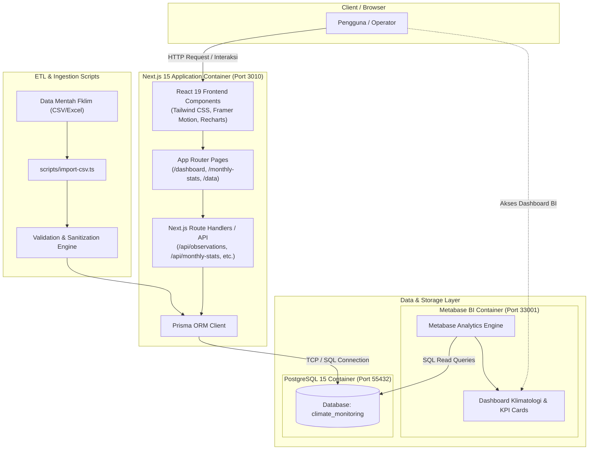
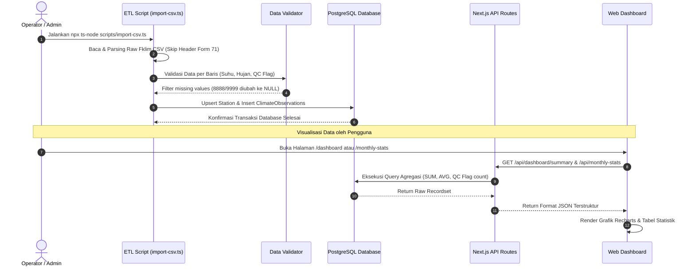
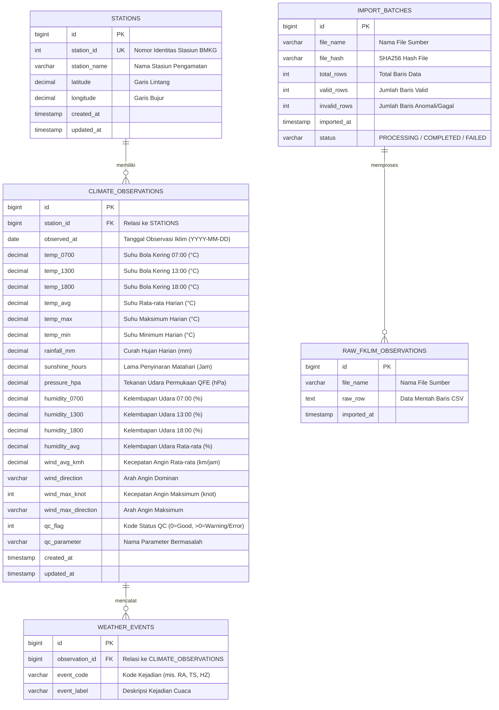

# 🌦️ Climate Monitoring Dashboard & BMKG Data Analysis

Sistem monitoring, analisis, dan visualisasi data klimatologi interaktif berbasis **Next.js 15**, **PostgreSQL**, dan **Metabase**. Proyek ini mengolah data observasi iklim harian standar **BMKG Form Fklim 71** (Stasiun Meteorologi Tunggul Wulung, Cilacap) menjadi dashboard analitik interaktif, kalender pemantauan anomali cuaca (Quality Control Flag), serta tabel rekapitulasi statistik bulanan.

---

## 📑 Daftar Isi
- [Fitur Utama](#-fitur-utama)
- [Arsitektur Sistem (UML Diagram)](#-arsitektur-sistem-uml-diagram)
- [Alur Proses Data / ETL (Sequence Diagram)](#-alur-proses-data--etl-sequence-diagram)
- [Entity Relationship Diagram (ERD)](#-entity-relationship-diagram-erd)
- [Kamus Data (Data Dictionary)](#-kamus-data-data-dictionary)
- [Logika Perhitungan & Formula Statistik](#-logika-perhitungan--formula-statistik)
- [Daftar Endpoint API](#-daftar-endpoint-api)
- [Tech Stack](#-tech-stack)
- [Panduan Instalasi & Cara Menjalankan](#-panduan-instalasi--cara-menjalankan)
- [Kebijakan Data Sensitif](#-kebijakan-data-sensitif)

---

## ✨ Fitur Utama

1. **Dashboard Monitoring Interaktif (`/dashboard`):**
   - **Key Performance Indicators (KPI):** Akumulasi curah hujan tahunan, rata-rata suhu harian, kelembapan rata-rata, dan kecepatan angin puncak.
   - **Grafik Tren Harian:** Visualisasi time-series interaktif fluktuasi suhu (maksimum, minimum, rata-rata) dan volume curah hujan harian berbasis [Recharts](https://recharts.org/).
   - **Kalender Interaktif QC Warning:** Kalender bulanan dinamis yang menandai hari-hari observasi yang memiliki kode peringatan / anomali data (`qc_flag > 0`) dilengkapi tooltip rincian parameter yang terdampak.
2. **Statistik & Rekapitulasi Bulanan (`/monthly-stats`):**
   - Tabel statistik bulanan komprehensif (Januari – Desember) mencakup 23 parameter meteorologi lengkap dengan kalkulasi nilai rata-rata (*Average*) dan total (*Sum*).
   - Grafik batang & garis perbandingan musiman antar bulan.
   - Fitur **Export to CSV** untuk pelaporan lanjutan.
3. **Data Explorer Lengkap (`/data`):**
   - Tabel data observasi harian mentah dengan dukungan pencarian, pengurutan kolom, dan pagination.
4. **Metabase BI Dashboard:**
   - Visualisasi analitik tersentralisasi terhubung langsung ke PostgreSQL dengan kartu agregasi instan.

---

## 🏛️ Arsitektur Sistem (UML Diagram)

Diagram berikut menggambarkan komponen sistem dan interaksi antar container layanan:



---

## 🔄 Alur Proses Data / ETL (Sequence Diagram)

Diagram sekuens berikut memodelkan alur ingestion data dari file mentah hingga disajikan pada antarmuka dashboard:



---

## 🗄️ Entity Relationship Diagram (ERD)

Struktur relasi basis data yang didefinisikan menggunakan Prisma ORM:



---

## 📖 Kamus Data (Data Dictionary)

### 1. Tabel `stations`
| Kolom | Tipe Data | Constraint | Keterangan |
| :--- | :--- | :--- | :--- |
| `id` | `BIGINT` | PRIMARY KEY, AUTO_INCREMENT | Identifier unik internal |
| `station_id` | `INT` | UNIQUE, NOT NULL | Kode ID stasiun BMKG resmi (contoh: `96805`) |
| `station_name` | `VARCHAR(255)` | NOT NULL | Nama stasiun (contoh: *Stasiun Meteorologi Tunggul Wulung*) |
| `latitude` | `DECIMAL(9,6)` | NOT NULL | Posisi garis lintang (-7.718600) |
| `longitude` | `DECIMAL(9,6)` | NOT NULL | Posisi garis bujur (109.014800) |

### 2. Tabel `climate_observations`
| Kolom | Tipe Data | Constraint | Keterangan |
| :--- | :--- | :--- | :--- |
| `id` | `BIGINT` | PRIMARY KEY, AUTO_INCREMENT | ID unik observasi |
| `station_id` | `BIGINT` | FOREIGN KEY (`stations.id`) | Relasi stasiun pengamat |
| `observed_at` | `DATE` | NOT NULL, INDEX | Tanggal data cuaca diamati |
| `temp_0700` | `DECIMAL(5,2)` | NULLABLE | Suhu udara pukul 07:00 WIB (°C) |
| `temp_1300` | `DECIMAL(5,2)` | NULLABLE | Suhu udara pukul 13:00 WIB (°C) |
| `temp_1800` | `DECIMAL(5,2)` | NULLABLE | Suhu udara pukul 18:00 WIB (°C) |
| `temp_avg` | `DECIMAL(5,2)` | NULLABLE | Rata-rata temperatur harian (`tbk_avg`) |
| `temp_max` | `DECIMAL(5,2)` | NULLABLE | Temperatur maksimum harian |
| `temp_min` | `DECIMAL(5,2)` | NULLABLE | Temperatur minimum harian |
| `rainfall_mm` | `DECIMAL(8,2)` | NULLABLE | Total curah hujan harian (mm) |
| `sunshine_hours` | `DECIMAL(6,2)` | NULLABLE | Lama penyinaran matahari (Jam) |
| `pressure_hpa` | `DECIMAL(7,2)` | NULLABLE | Tekanan udara rata-rata harian (QFE) |
| `humidity_avg` | `DECIMAL(5,2)` | NULLABLE | Rata-rata kelembapan udara harian (%) |
| `wind_avg_kmh` | `DECIMAL(6,2)` | NULLABLE | Rata-rata kecepatan angin (km/jam) |
| `wind_max_knot` | `INT` | NULLABLE | Kecepatan angin maksimum dalam knot |
| `qc_flag` | `INT` | DEFAULT 0, INDEX | `0`: Data terverifikasi, `>0`: Terdapat anomali/kosong |
| `qc_parameter` | `VARCHAR(255)` | NULLABLE | Keterangan kolom anomali (mis. `ss_8`, `rr_0700`) |

---

## 🧮 Logika Perhitungan & Formula Statistik

Perhitungan statistik bulanan pada endpoint `/api/monthly-stats` dan dashboard Metabase menggunakan standar agregasi SQL dan kaidah meteorologi:

1. **Total Curah Hujan Bulanan (mm):**
   $$\text{Total Hujan} = \sum_{i=1}^{N} \text{rainfall\_mm}_i$$
   *(Hanya menjumlahkan baris yang bernilai angka valid; nilai data hilang `NULL`/`8888` diabaikan).*

2. **Rata-rata Suhu & Kelembapan Bulanan:**
   $$\bar{X} = \frac{\sum_{i=1}^{k} X_i}{k}$$
   *Di mana $k$ adalah jumlah hari dengan nilai pengamatan valid ($X \neq \text{NULL}$), sehingga pembagian tidak bias oleh hari kosong.*

3. **Penanganan Missing Data BMKG:**
   - Nilai string `8888` (alat rusak/tidak terukur) atau `9999` (tidak ada data) otomatis disanitasi menjadi `NULL` pada proses ingest.
   - Kolom `qc_flag` dengan nilai `> 0` dihitung sebagai indikator `Hari Warning` untuk pemantauan kualitas data stasiun.

---

## 🔌 Daftar Endpoint API

| Method | Endpoint | Deskripsi |
| :--- | :--- | :--- |
| `GET` | `/api/dashboard/summary` | KPI ringkasan tahunan & rata-rata keseluruhan |
| `GET` | `/api/monthly-stats` | Statistik agregasi per bulan (23 parameter) |
| `GET` | `/api/observations/all` | Seluruh data harian untuk DataTable (paging/sorting) |
| `GET` | `/api/observations/temperature` | Data time-series suhu harian (pagi, siang, sore, min, max) |
| `GET` | `/api/observations/rainfall` | Data time-series curah hujan harian |
| `GET` | `/api/observations/humidity` | Data time-series kelembapan udara |
| `GET` | `/api/observations/wind` | Data kecepatan & arah angin harian |
| `GET` | `/api/quality/summary` | Ringkasan Quality Control flag & daftar hari anomali |

---

## 🛠️ Tech Stack

- **Framework Web:** Next.js 15 (App Router), React 19, TypeScript
- **Styling & UI:** Tailwind CSS, Lucide React Icons, Framer Motion
- **Visualisasi Grafik:** Recharts
- **Database & ORM:** PostgreSQL 15, Prisma ORM
- **Business Intelligence:** Metabase
- **DevOps & Container:** Docker, Docker Compose

---

## ⚙️ Panduan Instalasi & Cara Menjalankan

### 1. Kloning Repositori
```bash
git clone https://github.com/Heat4Cliff/climate-monitoring.git
cd climate-monitoring
```

### 2. Salin File Konfigurasi Lingkungan
```bash
cd climate-monitoring
cp .env.example .env
```

### 3. Jalankan Docker Compose
Jalankan container PostgreSQL, Metabase, dan Next.js:
```bash
docker compose up -d
```

### 4. Setup Database & Ingest Data
```bash
# Push schema database ke PostgreSQL
npx prisma db push

# Jalankan script pengolahan data mentah CSV
npx ts-node scripts/import-csv.ts
```

### 5. Akses Layanan
- **Web Dashboard:** [http://localhost:3010](http://localhost:3010)
- **Metabase BI:** [http://localhost:33001](http://localhost:33001)
- **PostgreSQL Database:** `localhost:55432` (`user: postgres`, `pass: postgrespassword`, `db: climate_monitoring`)

---

## 🔒 Kebijakan Data Sensitif

Sesuai dengan standar perlindungan data observasi BMKG:
- File mentah (`*.csv`, `*.xlsx`, `*.xls`) dan file rahasia lingkungan (`.env*`) dikecualikan secara permanen melalui `.gitignore`.
- Repositori ini hanya memuat kode sumber, skema database, dokumentasi arsitektur, dan template konfigurasi lingkungan.
